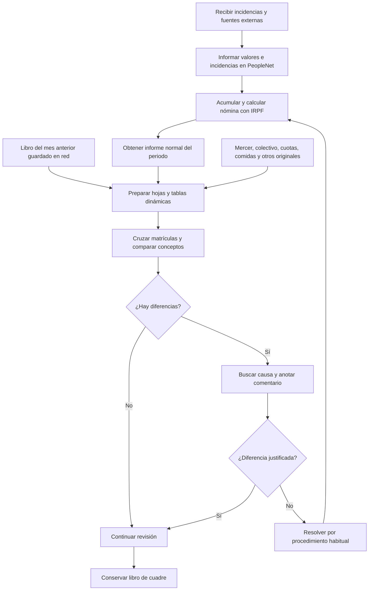
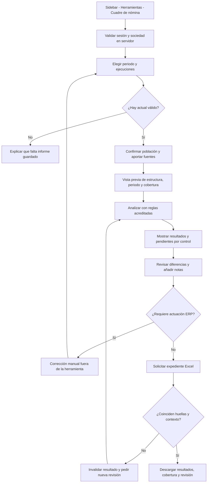
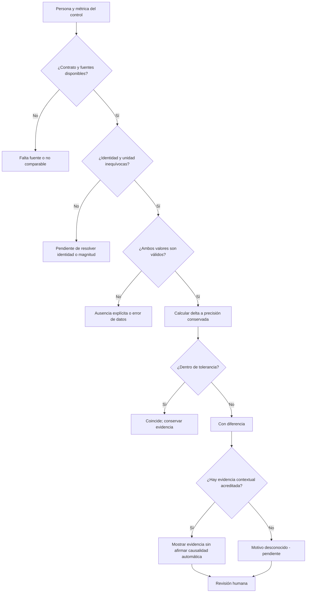
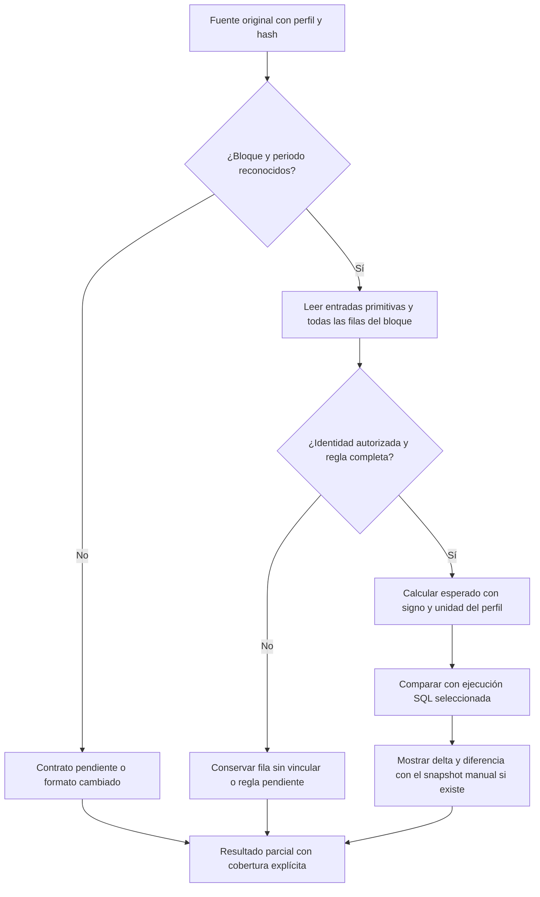

# Flujos del cuadre de nómina

Los diagramas actuales sintetizan hechos E02–E24 de [AS_IS](AS_IS.md).
Los diagramas futuros son propuestas; no representan rutas ya implementadas.

## Proceso manual observado



La carga de datos y el cálculo ERP son prerrequisitos observados. La nueva
herramienta no ejecutará B, C ni M en su primera versión.

## Flujo propuesto de usuario



## Flujo técnico propuesto

```mermaid
sequenceDiagram
  actor U as Usuario RRHH
  participant UI as Pantalla de cuadre
  participant API as Handlers Node.js
  participant CTX as Sesión y contexto operativo
  participant SQL as Lectores PeopleNet
  participant PAR as Perfiles de archivos
  participant ENG as Motor puro
  U->>UI: Seleccionar ejecuciones y ficheros
  UI->>API: Preview con fuentes y metadatos
  API->>CTX: Validar sesión, contexto y origen
  API->>PAR: Validar límites, estructura y periodo
  PAR-->>API: Contratos reconocidos o pendientes
  API-->>UI: Vista previa mínima
  U->>UI: Confirmar población y analizar
  UI->>API: Claves, fuentes y reglas permitidas
  API->>CTX: Resolver sociedad en servidor
  API->>SQL: Releer ejecuciones con sociedad parametrizada
  SQL-->>API: Cabeceras y filas originales
  API->>PAR: Normalizar fuentes sin ejecutar contenido
  PAR-->>API: Valores y evidencia de origen
  API->>ENG: Comparar entradas acreditadas
  ENG-->>API: Hallazgos y cobertura
  API->>CTX: Comprobar vigencia del contexto
  API-->>UI: Resultado seguro y huellas
  U->>UI: Anotar revisión y exportar
  UI->>API: Entradas, huella y anotaciones
  API->>SQL: Releer con contexto válido
  API->>ENG: Recalcular y verificar huella
  alt Datos o contexto cambiados
    API-->>UI: Resultado obsoleto; revisar de nuevo
  else Evidencia idéntica
    API-->>UI: Excel en memoria, no-store
  end
```

No hay flecha hacia el chat, un modelo de lenguaje, escrituras SQL, servicios
de cálculo ERP ni portales externos.

## Decisión por hallazgo



Una ausencia explícita de persona en una ejecución es un resultado de
cobertura. No implica, por sí sola, una baja laboral ni un importe cero.

## Dependencias e invalidación

| Cambia                                  | Recalcular / invalidar                                      |
| --------------------------------------- | ----------------------------------------------------------- |
| Ejecución actual o su contenido         | Todos los controles y revisiones cuyo operando cambie.      |
| Ejecución anterior                      | C01, C02, C08 y C15.                                        |
| Fuente Mercer                           | C03 y sus subcontroles.                                     |
| Colectivo/tarifa/calendario teletrabajo | C05.                                                        |
| Comisiones y ventana                    | C06.                                                        |
| Archivos/cuotas apartamentos            | C07, conservando distintas estancias.                       |
| Ausencias/valoración comida             | C09.                                                        |
| Pedido/descargas/reparto tarjeta        | C10.                                                        |
| Registro de excesos                     | C11.                                                        |
| Calendario anticipos                    | C12.                                                        |
| Lista anual/referencia de aniversarios  | C13.                                                        |
| Calendario personal de pensiones        | C14.                                                        |
| Altas/cuota mensual de gimnasio         | C16.                                                        |
| Regla, perfil o tolerancia              | Controles dependientes; revisar su huella de evidencia.     |
| Sociedad o sesión                       | Vaciar la visita y descartar todas las respuestas en curso. |

Los cambios de fuente no hacen que un resultado antiguo cambie de forma
invisible. Una anotación se reutiliza únicamente si su hallazgo y la evidencia
siguen siendo idénticos.

## Validación de originales propuesta



Ni el color, ni una celda «OK», ni la coincidencia con una copia de nómina
convierten una fuente derivada en independiente. Las excepciones de
[VALIDATION](VALIDATION.md) deben mantenerse visibles hasta resolverlas.
